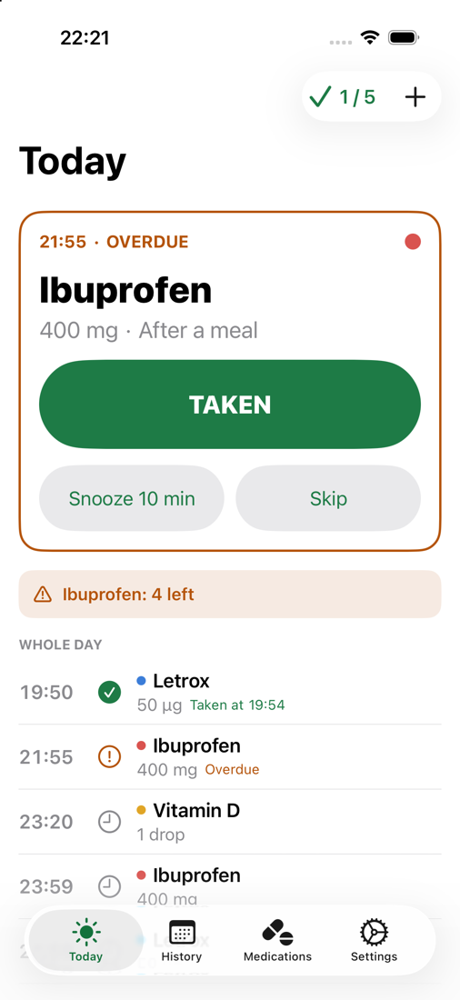
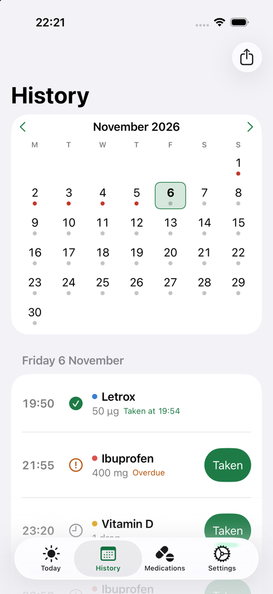
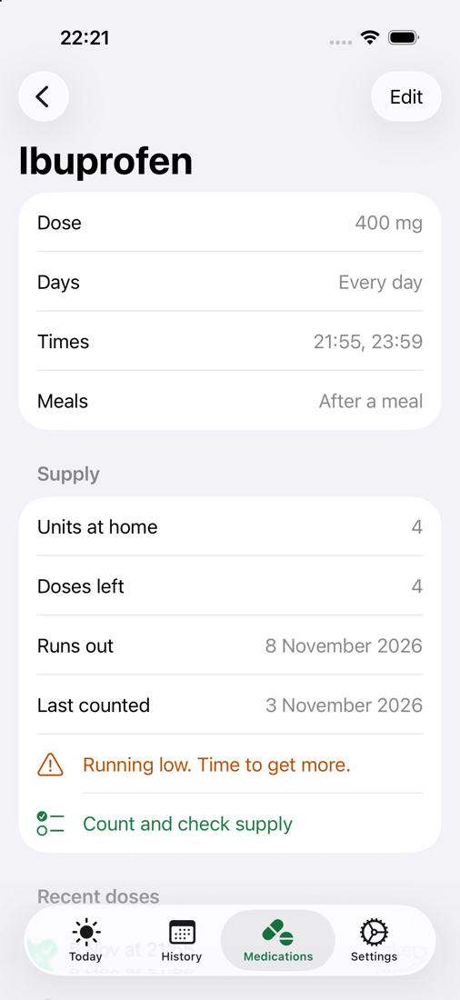
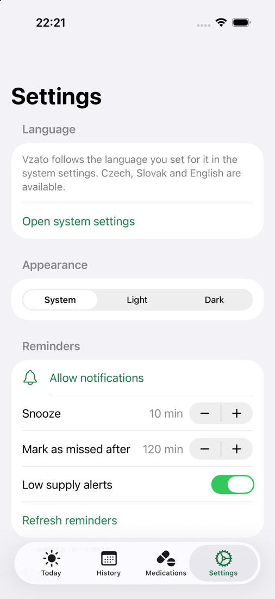

# Vzato

Free, open source medication reminder for iPhone, iPad and Mac. One SwiftUI code
base, no server, no accounts. Your data stays on your devices and, once sync
ships, in your own iCloud. Czech, Slovak and English.

**Vzato is not a medical device and does not replace your doctor or pharmacist.**
It reminds you and keeps your own notes, nothing more. It never suggests doses
and never checks interactions.

*Vzato* means "taken" in Czech. That is the whole idea: one tap to say you took
it, and the certainty that you did not take it twice.

<p align="center">
  
  
  
  
</p>

## Features

**Today.** One large card for the dose that needs attention: overdue, missed, or
the next one. A big *Vzato* button, snooze and skip. The rest of the day as a
timeline with the time each dose was confirmed.

**Reminders.** Local notifications with *Taken / Snooze / Skip* actions. Works
with the app closed. No push server.

**History.** Month calendar with a status dot per day, per-day corrections
(mark as taken late, skip, reset), monthly adherence, CSV export.

**Supply.** Pill count per medication, automatic decrement on each confirmed
dose, warning and notification when running low, projected run-out date.

**Supply check.** Count what you have at home and compare it with what the app
recorded. Catches doses you took without confirming, or confirmed without
taking, and can backfill the records.

**Extra doses.** Log a painkiller or anything outside the plan; it shows in the
history and lowers the supply.

**Languages.** Czech, Slovak and English, following the language you choose for
the app in system settings.

Planned, in the order people ask for it: photos of the package, pill and
leaflet, iCloud sync, widgets, Apple Health, profiles for children and pets,
family sharing, hand-over of records by QR code or encrypted export, official
leaflets from the Czech and Slovak medicines databases. The Czech design
documents have the details: [specification.md](specification.md),
[implementation-plan.md](implementation-plan.md),
[design-options.md](design-options.md).

## Requirements

- iOS 17, iPadOS 17 or macOS 14 and newer.
- Building: Xcode 16 or newer and [XcodeGen](https://github.com/yonaskolb/XcodeGen).

## Building

```bash
brew install xcodegen
cp Config/Local.xcconfig.example Config/Local.xcconfig   # add your team, or keep the placeholder
xcodegen generate
open Vzato.xcodeproj
```

Simulator builds need no Apple developer team. Device builds, TestFlight and
macOS do: set `DEVELOPMENT_TEAM` in `Config/Local.xcconfig`, which is gitignored.

Command line:

```bash
xcodebuild -project Vzato.xcodeproj -scheme Vzato \
  -destination 'platform=iOS Simulator,name=iPhone 17 Pro' build
xcodebuild -project Vzato.xcodeproj -scheme Vzato \
  -destination 'platform=iOS Simulator,name=iPhone 17 Pro' test
```

Debug builds accept the launch argument `--sample-data`, which fills an empty
store with demo medications.

## TestFlight

1. In App Store Connect create the app record once: name *Vzato*, bundle ID
   `app.vzato`, primary language Czech.
2. Make sure `Config/Local.xcconfig` contains your `DEVELOPMENT_TEAM`.
3. In Xcode: Product › Archive (scheme *Vzato*, destination *Any iOS Device*),
   then Distribute App › TestFlight & App Store. Automatic signing registers
   the App ID and creates the profiles.
4. Add testers to an internal group in App Store Connect; the build appears in
   the TestFlight app within minutes.

Command line equivalent:

```bash
xcodebuild -project Vzato.xcodeproj -scheme Vzato -destination 'generic/platform=iOS' \
  -archivePath build/Vzato.xcarchive archive
xcodebuild -exportArchive -archivePath build/Vzato.xcarchive \
  -exportOptionsPlist Config/ExportOptions.plist -exportPath build/export
```

## Privacy

No analytics, no ads, no third-party code, no server. Everything is stored in
the app's local database and, once sync ships, in the user's private iCloud
database, which the developer cannot access. The only network requests the app
will ever make on its own are to Apple (iCloud) and, on an explicit tap, to the
public medicines databases of the Czech and Slovak state institutes to fetch a
leaflet. The privacy manifest declares no collected data.

## Project layout

```
Vzato/App         app entry, root tabs, Core Data stack, settings keys
Vzato/Models      Core Data model and NSManagedObject subclasses
Vzato/Services    scheduling, dose logging, supply, supply check, notifications, CSV
Vzato/Views       SwiftUI screens, shared by iPhone, iPad and Mac
Vzato/Resources   String Catalog (en, cs, sk), assets, privacy manifest
VzatoTests        Swift Testing unit tests
Config            signing (local, gitignored), entitlements, export options
Design/icon       app icon drafts (SVG)
Scripts           helper scripts
```

## Contributing

Issues and pull requests are welcome. Read [CONTRIBUTING.md](CONTRIBUTING.md)
first; it is short. Changes are listed in [CHANGELOG.md](CHANGELOG.md).

## License

[Mozilla Public License 2.0](LICENSE). The name *Vzato* and the app icon are
not covered by the license and may only be used by official builds.
